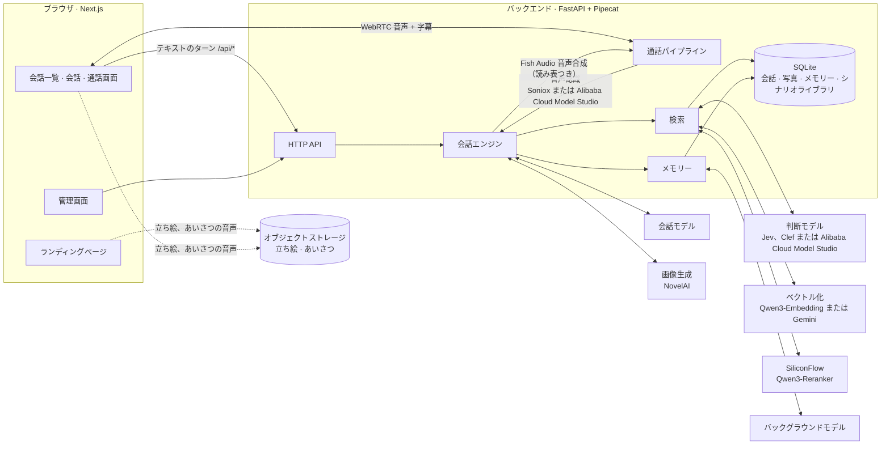

# Eidolon Yoibanashi · 夜更けのひと声

作者：[S-Elirch](https://github.com/S-Elirch) · [リポジトリ](https://github.com/S-Elirch/Eidolon_Yoibanashi)

[Sallyn0225/eidolon-sc](https://github.com/Sallyn0225/eidolon-sc) **v0.2.0** を基にした個人 Fork です。夜に彼女の会話画面を開くと、向こうから声をかけてくれることがあります。

[デモ](#デモ) · [使い方](#使い方) · [対応範囲](#対応範囲) · [機能と開発の説明](FORK.md)（中国語） · [元のプロジェクト](#元の-eidolon-sc-について)

夜も更けて、ふと彼女と話したくなる。こちらが話しかけるより先に、彼女からひと言。挨拶だったり、いつか話したことの続きだったり。そんなひとときを目指しています。

話しかけるかどうか、何を話すか、いつメッセージが届くかは、関係の深さ、最近の会話、使える話題、待ち時間によって決まります。文字を打っているとき、何を話すか考えているとき、前の会話を読み返しているときに、ふと彼女の言葉が届くような体験です。

この Fork の追加機能は、Codex と協力し、Vibe Coding で開発しました。設計上の判断、実装、テストした範囲は [FORK.md](FORK.md)（中国語）にまとめています。

## デモ

<table>
  <tr>
    <td width="33%" valign="top">
      
      <p align="center"><sub><b>彼女から先に</b><br>まだ送信していないうちに、前に話したことを聞いてくれます。</sub></p>
    </td>
    <td width="33%" valign="top">
      
      <p align="center"><sub><b>あなたが先に</b><br>メッセージを送ると、彼女はその言葉に返事をします。</sub></p>
    </td>
    <td width="33%" valign="top">
      
      <p align="center"><sub><b>入力中に、彼女の言葉が届く</b><br>書きかけの文章はそのまま。まずは彼女の話を読んでみましょう。</sub></p>
    </td>
  </tr>
</table>

スマートフォンの画面サイズに合わせたブラウザーでの録画です。実際の LLM の返答、テスト用データ、模擬時計を使っています。

## 使い方

この Fork のソースから [docker-compose.yml](docker-compose.yml) を使ってビルドしてください。元のプロジェクトが配布しているビルド済みイメージには、この機能は含まれません。

初めて使う場合は、この Fork の `my-features` のソースをダウンロードします。`.env.example` を `.env` にコピーし、少なくとも `CHAT_LLM_BASE_URL`、`CHAT_LLM_API_KEY`、`CHAT_LLM_MODEL` を設定してください。モデルには文章の順次出力とツール呼び出しの対応が必要です。ソースのルートで次を実行します。

```sh
docker compose up -d --build
```

<http://localhost:3000> を開きます。自分のパソコンで試す場合は、`.env` に `EIDOLON_DEV_LOGIN=1` を設定すると開発用ログインを使えます。公開するサーバーでは[導入ガイド](docs/deploy.md)に従って通常のログインを設定してください。記憶の検索、親密度、音声は必要に応じて[設定ガイド](docs/configuration.ja.md)から追加できます。

**設定 → 声かけ → 夜の出会い**（画面の表記：**设置 → 搭话 → 夜间相遇**）でモードを選びます。初期設定はオフです。プロフィールのタイムゾーンを使い、**22:00〜翌日 05:00** に動作します。元からあるバックグラウンドの声かけとは別に設定します。

初めて試すときは、彼女と一度は普通に言葉を交わしてから「今夜は、あなたから話してほしい」を選び、今の会話画面を開き直してください。先に送信せず、少しそのまま待ちます。親密度の機能が有効な場合は「信頼」以上の関係が必要です。無効な場合は関係の段階による抽選は行いません。5〜8 秒は準備を始めるまでの待ち時間で、文章の生成と表示にはさらに時間がかかります。

- **自然な出会い（自然偶遇）**：関係の深さに応じて機会を抽選します。少し待つと、彼女から話しかけることがあります。合う話題がなければ、何も送らないこともあります。
- **今夜は、あなたから話してほしい（今晚想听你先说）**：彼女からの声かけを試したい夜に選べます。待ち時間は 5〜8 秒で、通常の機会抽選と一部の回数・間隔制限を省きます。ただし、関係の条件、まだ返事をしていない声かけ、通話中などの状態によっては届きません。チャットを開くたびに必ず話しかけるわけではありません。次の夜は「自然な出会い」に戻ります。

あなたが先に送信した場合、まだ表示を始めていない声かけは取りやめ、通常の返答に進みます。モデルへのリクエストが始まった後は、ページの更新や移動だけでは生成と保存を中止しません。通常の条件を確認したうえで、ページを離れている間にメッセージが完成し、保存されることがあります。

詳しいルール、API の利用コスト、設計上の判断、他の Fork との接続方法は、[FORK.md](FORK.md) と[モジュールの説明](backend/src/eidolon/visit_outreach/README.md)をご覧ください。どちらも中国語です。

## 更新と旧版への戻し方

既存の v0.2.0 環境から更新する前に、バックアップを取ってください。Compose のプロジェクト名は元のままにするのが簡単です。名前を変える場合も、元のデータ用ボリュームを明示して使ってください。フォルダー名を変えると空のボリュームが新しく作られ、記録がなくなったように見えることがあります。更新のために `docker compose down -v` を実行しないでください。

元のプロジェクトの **v0.2.0** に戻す場合は、イメージを替えるだけでは不十分です。旧版はこの機能の追加テーブルを削除しないため、機能を有効にした後ではアカウント削除時に外部キーのエラーが出ることがあります。次の二つの方法があります。

- **更新前のバックアップに戻す**：プログラムとデータベースを一緒に旧版へ戻します。そのバックアップには更新後の会話、記憶、設定は含まれないため、現在のデータベースも別に保存してください。
- **最近の記録を残し、追加機能のデータだけを削除する**：バックエンドを停止し、現在のデータベース全体を保存します。そのコピーで下の三つのテーブルだけを削除します。データベースに問題がなく、元の記録も変わっていないことを確認してください。v0.2.0 で記録の読み取りとアカウント削除を試してから、整理したデータベースと旧版に切り替えます。

| 追加テーブル | 削除する内容 |
|---|---|
| `visit_outreach_on` | 夜の出会いと今夜のモードの設定 |
| `dev2_night_tasks` | 生成処理の状態と準備した文章の控え |
| `dev2_night_opportunities` | 各夜の機会抽選の記録 |

二つ目の方法では、元のアカウント、会話、記憶、親密度と `reach_outs` テーブルを残します。正式に保存した声かけも元の `reach_outs` に入るため、削除しません。作業中はバックエンドを止めたままにし、書き込みや追加テーブルの再作成を防いでください。SQLite のバックアップ用 API を使うか、バックエンドを完全に停止してから全体を保存してください。動作中の `.db` ファイルだけをコピーすると、WAL にあるデータが抜けることがあります。

**確認した範囲**：更新時に元の記録が保たれることと、そのまま旧版へ戻すと外部キーのエラーが出ることは確認済みです。上の三つのテーブルを削除する移行ツールは、まだ用意・検証していません。これは戻し方の方針であり、検証済みの自動機能ではありません。データベースの変更が異なる他の版や Fork には、そのまま使えません。

## 対応範囲

- **開発の基準**：Eidolon-SC **v0.2.0**。通常の返答と元からあるバックグラウンドの声かけは、元の処理を使います。
- **Hibi での確認**：[Eidolon-Hibi](https://github.com/x499806631-commits/Eidolon-Hibi) の `my-features` ブランチ、コミット `1fb2454` で、個別の接続対応とフロントエンドの変更を行いました。実際の LLM による声かけ、文章の順次表示、通常の返答への切り替え、メッセージの保存、ページ更新後の復元を確認しています。
- **確認した範囲**：Hibi での確認には、共通の会話履歴、記憶、基本的な親密度の情報を使いました。Hibi 独自の予定情報や、忙しい時間を避けるルールはまだ接続していません。Hibi や他の Fork で使うには、バックエンドの接続とフロントエンドの変更が必要です。そのまま追加できるプラグインではなく、プロジェクトに組み込むモジュールです。

---

## 元の eidolon-sc について

以下は、原作者 [Sallyn0225](https://github.com/Sallyn0225) によるプロジェクト紹介と、共通の導入・設定ガイドです。上の部分はこの Fork の追加機能、下の部分は元のプロジェクトについて説明しています。

<div align="center">


**『アイドルマスター シャイニーカラーズ』のアイドルとリアルタイムで話せる AI 分身**

音声 · テキスト · コミュの記憶 · キャラクター間で共有されるメモリー

[简体中文](README.md) · [English](README.en.md) · **日本語**

[](https://github.com/Sallyn0225/eidolon-sc/actions/workflows/ci.yml)
[](backend/pyproject.toml)
[](https://fastapi.tiangolo.com/)
[](https://github.com/pipecat-ai/pipecat)
[](frontend/package.json)
[](frontend/package.json)
[](docker-compose.yml)
[](LICENSE)

[プレビュー](#-プレビュー) · [特長](#-特長) · [クイックスタート](#-クイックスタート) · [設定ガイド](docs/configuration.ja.md) · [デプロイ](docs/deploy.md) · [設計判断](docs/adr/)

</div>

---

Eidolon-SC では、**283プロのプロデューサー**として原作のアイドルとチャットしたり、そのまま電話したりできます。アイドルは日本語の声で答え、中国語字幕が付きます。原作で自分が経験したコミュを思い出せるうえ、あなたが話したことも覚えていて、アイドルたちのあいだで「伝わって」いきます。

原作の 8 ユニット・**28 人のアイドル**と事務員の七草はづきがすべて設定済みで、すぐに話せます。公開サーバーにデプロイすれば、誰でも Google または GitHub でログインして使えます。

> [!IMPORTANT]
> 本プロジェクトは非公式のファンメイド作品であり、バンダイナムコおよび『アイドルマスター』シリーズの権利者とは一切関係ありません。アイドルは AI が演じています。シナリオデータは**リポジトリに含まれていない**ため、各自で用意してください（[ADR-0003](docs/adr/0003-corpus-and-voices-stay-private.md)）。アイドルの返事を通じてコミュの内容が間接的にログインユーザーへ提供されるリスクについては [ADR-0006](docs/adr/0006-open-to-the-public-with-oauth.md) を参照してください。

## 📸 プレビュー

<p align="center">
  
  <br>
  <sub>真乃に電話：あなたは中国語で話し、真乃は日本語の声で答えます。字幕は同時に表示され、立ち絵はひとまとまりごとの感情で表情を変えます</sub>
</p>

<table>
  <tr>
    <td width="50%">
      <picture>
        <source media="(prefers-color-scheme: dark)" srcset="docs/images/app-dark.webp">
        
      </picture>
      <p align="center"><sub><b>キャラクター間で共有されるメモリー</b>：猫を飼っていると話したのは灯織だけなのに、恋鐘が「灯織から聞いたばい」</sub></p>
    </td>
    <td width="50%">
      
      <p align="center"><sub><b>着替え</b>：原作のどのカードの衣装も着られ、私服とステージ衣装を切り替えられます</sub></p>
    </td>
  </tr>
  <tr>
    <td width="50%">
      
      <p align="center"><sub><b>写真</b>：頼めば、その場の自分を一枚撮って送ってくれます</sub></p>
    </td>
    <td width="50%">
      
      <p align="center"><sub><b>プレイ</b>：抽選、プレゼント、実績、カレンダー</sub></p>
    </td>
  </tr>
  <tr>
    <td colspan="2">
      
      <p align="center"><sub><b>スケジュール</b>：毎週月曜に公開される仕事をアイドルたちの 1 週間に組み込み、保存すれば彼女に伝わる</sub></p>
    </td>
  </tr>
</table>

<table>
  <tr>
    <td width="33%"></td>
    <td width="33%"></td>
    <td width="33%"></td>
  </tr>
  <tr>
    <td align="center"><sub>会話一覧：最近やり取りした順に並び、中国語訳名・かな・ローマ字・ユニット名で検索できます</sub></td>
    <td align="center"><sub>日本語のセリフにはすべて中国語字幕が付きます</sub></td>
    <td align="center"><sub>スマートフォンでは通話画面が全画面になります</sub></td>
  </tr>
</table>

<details>
<summary><b>ランディングページ</b>：一筋の白い光が 29 色のイメージカラーに分かれ、その一本一本がひとりのキャラクター</summary>

<br>


</details>

## ✨ 特長

**彼女と話す**

- 🎙️ **リアルタイム音声通話**：WebRTC による全二重通話で、中国語でも日本語でも話せます。いつでも割り込めます。
- 🇯🇵 **日本語の声 + 中国語字幕**：アイドルは日本語で答え、口癖もそのまま、一文ごとに中国語字幕が付きます（[ADR-0001](docs/adr/0001-japanese-replies-with-chinese-subtitles.md)）。固有名詞は読み表どおりに読みます。
- 🎭 **動く立ち絵**：通話中は原作の Spine 立ち絵が呼吸し、まばたきし、口を動かし、感情に合わせて表情を変えます。新しいカードも週 1 回の同期で着られます。
- 📷 **写真を送ってくれる**：頼めば、自分の姿とその場の状況に合わせて一枚撮って送ってくれます。全年齢の内容だけです（[設定ガイド](docs/configuration.ja.md#写真)）。
- 💗 **好感度とプレゼント**：あなたの言葉しだいで心を開いたり距離を置いたりします。傷つけすぎると電話を切られ、会話も終わらせられます。「玩法」（プレイ）で毎日抽選して手に入れたプレゼントを贈ると、応えてくれます。実績を解放すると抽選回数も増やせます。
- 📅 **カレンダー**：アイドルとプロデューサーの誕生日、日本の祝日。当日はアイドルも知っています。
- 🗓️ **スケジュール**：毎週公開される仕事を彼女の 1 週間に組み込むと、彼女はそれを知っていて、それをふまえて話します。終えた仕事が彼女をあなたに近づけます（[設定ガイド](docs/configuration.ja.md#スケジュール)）。
- 💌 **声かけ**：しばらく来ないと、会話の中でアイドルのほうから話しかけてくれます。親しいほど早く来ます（[設定ガイド](docs/configuration.ja.md#声かけ)）。

**彼女が覚えていること**

- 📖 **コミュの記憶**：シナリオライブラリを取り込むと、**自分が登場した**正規ルートのコミュだけを思い出します。
- 🔄 **原作との同期**：ファン翻訳と日本語原文をコマンド 1 つで同期し、新しいカードやイベントも 1 週間以内に思い出せます。楽曲やライブも世界設定に入っています。
- 🧠 **キャラクター間で共有されるメモリー**：灯織に話したことは恋鐘も知っていて、「灯織から聞いたんだけど……」という口ぶりで持ち出します（[ADR-0002](docs/adr/0002-shared-memory-with-source-character.md)）。覚えていることはすべて確認・削除できます。
- 🗂️ **過去の会話**：いつでも新しい会話を始められ、前の会話は読み返せます。要らなければ削除もできます。
- 🪪 **プロデューサープロフィール**：呼び方・性別・タイムゾーン・誕生日を設定画面で変えられます。誕生日当日にはお祝いしてくれます。
- 📊 **統計**：アイドルたちとのやりとりの回数、通話時間、贈ったプレゼントを確認でき、シェア画像も書き出せます。
- ⚡ **必要なときだけ検索**：発言ごとに検索が必要かを先に判断するので、雑談では余計な遅延がありません。

**デプロイと運用**

- 👥 **一般公開**：Google または GitHub でログイン。ユーザーごとに利用上限があり、メモリーは分離されています。ユーザーは自分のデータを完全に削除でき、データベースは毎日暗号化して別の場所にバックアップします。
- 📦 **データパッケージ**：会話・写真・メモリー・プロデューサープロフィールを zip 一つに書き出し、別のデプロイで続きから使えます。好感度・プレゼント・スケジュールは持ち出せません（[ADR-0025](docs/adr/0025-data-packages-leave-affinity-and-gifts-behind.md)）。
- 🔑 **自前の API キー**：ユーザーは自分の LLM・音声合成・音声認識・画像生成のキーで自分のクレジットを使え、条件を満たせば利用上限に数えられません（[設定ガイド](docs/configuration.ja.md#自前の-api-キー)）。キーはブラウザーにだけ保存されます（[ADR-0017](docs/adr/0017-own-api-keys-stay-in-the-browser.md)）。
- 🛠️ **管理画面**：利用量・費用・進行中の通話の確認、モデルや利用上限の変更（再起動不要）、ユーザーの利用停止、お知らせの配信ができます。誰の会話もメモリーも見られません。
- 🚦 **サービス状況**：各サービスが正常かどうか、ユーザーは会話一覧から確認できます。
- 🔌 **サービスは差し替え可能**：モデルは OpenAI Chat Completions・Responses・Anthropic Messages の 3 方式に対応。音声認識とベクトル化は 2 社、判断モデルは 3 社から選べ、サービスごとにプロキシ経由にもできます。
- 🚀 **ワンコマンドでデプロイ**：Caddy（HTTPS 自動化）と coturn（TURN 中継）入りの Docker Compose 本番構成を同梱。CI がイメージをビルドして GHCR に公開します。

## 🚀 クイックスタート

Docker と Docker Compose、そしてストリーミング出力とツール呼び出しに対応した会話モデルが必要です。

```sh
git clone https://github.com/Sallyn0225/eidolon-sc.git && cd eidolon-sc
cp .env.example .env    # CHAT_LLM_BASE_URL・CHAT_LLM_API_KEY・CHAT_LLM_MODEL を記入し、EIDOLON_DEV_LOGIN=1 の 1 行も追加
docker compose up --build
```

<http://localhost:3000> を開くとランディングページです。右上の「登录」（ログイン）を押し、ログインパネルで「开发登录」（開発ログイン）を選んで好きな名前を入れ、プライバシーポリシーと利用規約に同意し、13 歳以上であることを申告すると会話一覧に入ります。アイドルを選べば会話が始まります。

会話モデルだけを設定した状態ではテキストチャットができます。必要に応じてほかのサービスのキーを追加すれば、音声通話・コミュの記憶・メモリー・立ち絵が段階的に有効になります：

| 機能 | 必要な設定 |
|---|---|
| テキストチャット | `CHAT_LLM_*` |
| 音声通話 | `FISH_AUDIO_API_KEY` と音声認識のキー：`SONIOX_API_KEY`（デフォルト）または Alibaba Cloud Model Studio の `DASHSCOPE_API_KEY` |
| シナリオライブラリ | ベクトル化のキー：`SILICONFLOW_API_KEY`（デフォルト）または `GEMINI_API_KEY` |
| 検索とメモリー | ベクトル化のキー、`SILICONFLOW_API_KEY`（並べ替え用）、判断モデル：`JEV_API_KEY`（デフォルト）、Cloudflare または Alibaba Cloud Model Studio の認証情報 |
| 写真 | 判断モデルと画像生成のキー：`NOVELAI_API_KEY` |
| 立ち絵とあいさつ | `EIDOLON_STAND_ASSETS_URL` と素材を置くストレージバケット |

それぞれの設定方法と設定したときの効果は **[設定ガイド](docs/configuration.ja.md)** を、すべての環境変数の説明は [`.env.example`](.env.example) を参照してください。

## 🧩 アーキテクチャ



- 文字入力も音声も**同じ会話エンジン**を通り、同じ会話記録に書き込まれます。通話はエンジンの外側に音声認識と音声合成を被せただけのものです。
- 会話モデルは `<ja>…</ja><zh>…</zh>` の区切り形式でストリーミング出力し、日本語が届いた時点で音声合成に回すため、返事全体が終わるのを待つ必要がありません。

## 📚 ドキュメント

| ドキュメント | 内容 |
|---|---|
| [設定ガイド](docs/configuration.ja.md) | モデル、キャラクター、通話、立ち絵、シナリオライブラリ、検索、メモリー、写真、ログイン、自前の API キー、ネットワークプロキシ、サービス状況、管理画面の設定と効果 |
| [デプロイガイド](docs/deploy.md)（中国語） | VPS へのデプロイ：ドメイン、ファイアウォール、OAuth、シナリオライブラリの週次同期、立ち絵とあいさつの素材、アップグレード、バックアップと復元、トラブルシューティング |
| [`.env.example`](.env.example) | すべての環境変数とその説明 |
| [アーキテクチャ決定記録](docs/adr/) | なぜこう設計したか：日本語の声、共有メモリー、一般公開、自前のキーはブラウザーにだけ保存、など |
| [`GLOSSARY.md`](GLOSSARY.md) | ドメイン用語集 |
| [コミュニティのフォーク](docs/community-forks.md)（中国語） | みんなが自分のフォークで作った遊び方と、自分のフォークを登録する方法 |
| [`DESIGN.md`](DESIGN.md) · [`PRODUCT.md`](PRODUCT.md) | ビジュアル仕様 · プロダクトの位置づけ |

## 🌐 デプロイ

本番構成 [`docker-compose.prod.yml`](docker-compose.prod.yml) は caddy（HTTPS の入口）、frontend、backend、coturn（TURN 中継）の 4 つのサービスからなり、フロントエンドとバックエンドのイメージは CI が GHCR に公開します：

```sh
docker compose -f docker-compose.prod.yml pull
docker compose -f docker-compose.prod.yml up -d
```

データベースは `deploy/db-backup.sh` が毎日暗号化して非公開のストレージバケットにバックアップし、初期状態では 30 日間保存します。詳しい手順は [デプロイガイド](docs/deploy.md)（中国語）を参照してください。

## 💻 開発

**バックエンド**（Python 3.11+、`backend/`、[uv](https://docs.astral.sh/uv/) を使用）：

```sh
cd backend
uv sync
uv run pytest && uv run pyright && uv run ruff check
uv run --env-file=../.env eidolon serve   # :8000 で起動し、../characters/characters.toml を読み込む
```

**フロントエンド**（Next.js 16 + [shadcn/ui](https://ui.shadcn.com/) + Tailwind CSS v4、`frontend/`）：

```sh
cd frontend
npm install
npm run typecheck && npm test && sh scripts/check-discipline.sh
npm run build && BACKEND_URL=http://localhost:8000 npm run start   # :3000 で起動し、/api/* をバックエンドへ転送
```

- **画面**：控えめな LINE 風のデザインで、彼女に属する場所には彼女のイメージカラーを使います。ランディングページは常にダークの、独立したビジュアルの世界です（[ADR-0016](docs/adr/0016-landing-page-is-its-own-visual-world.md)）。ビジュアル仕様は [`DESIGN.md`](DESIGN.md)、コンポーネントの書き方の決まりは [`frontend/AGENTS.md`](frontend/AGENTS.md) にあります。
- **立ち絵**：立ち絵を見るときは、フロントエンドにも `.env` と同じ `EIDOLON_STAND_ASSETS_URL` を渡します。
- **README のスクリーンショット**：フロントエンドとバックエンドを両方起動したあと、`frontend/` で `npm run readme-media` を実行すると、`docs/images/` のスクリーンショットとアニメーションを撮り直します。
- **CI**：PR と main へのプッシュごとに、GitHub Actions が上記のチェックと shellcheck を実行し、2 つのイメージをビルドします。main と `v*` タグへのプッシュでは GHCR に公開します。Dependabot が毎週月曜に依存関係の更新を提案します。

## 📁 ディレクトリ構成

```text
eidolon-sc/
├── backend/          # Python バックエンド：FastAPI + Pipecat。会話エンジン、通話、検索、メモリー、同期とコマンドライン（eidolon）
│   ├── src/eidolon/
│   ├── eval/         #   並べ替え・判断モデル・メモリーの評価用データセット（質問とラベルのみ、シナリオ本文は含まない）
│   └── tests/
├── frontend/         # Next.js フロントエンド：ランディングページ、会話、通話画面、設定、管理画面
├── characters/       # キャラクター設定、キャラクターシート、資料、アイコン、読み表、世界設定
├── corpus/           # シナリオデータとミラーのキャッシュ（リポジトリ外）
├── deploy/           # Caddyfile、シナリオライブラリと立ち絵の同期スクリプト、データベースのバックアップスクリプト
├── scripts/          # OAuth アプリ設定のウィザード（setup-oauth.sh）
├── docs/             # 設定ガイド、デプロイガイド、アーキテクチャ決定記録、README の画像
├── docker-compose.yml          # ローカル開発用
└── docker-compose.prod.yml     # 本番デプロイ用
```

## 📄 ライセンス

本プロジェクトのコードは [GNU Affero General Public License v3.0](LICENSE)（AGPL-3.0）、または（あなたの選択により）それ以降の任意のバージョンの下で公開されています。本プロジェクトを改変してネットワーク経由で他者にサービスを提供する場合は、その利用者に改変後のソースコードを公開する必要があります。

ライセンスの対象はリポジトリ内のコードとドキュメントだけで、次のものは対象外です：

- **原作のコンテンツ**：シナリオデータ、キャラクター音声、立ち絵素材はリポジトリに含まれておらず、利用時はそれぞれの提供元の条件に従う必要があります（ADR-0003）。リポジトリ内のキャラクターシート・キャラクター資料・アイコンと README のスクリーンショットについても、キャラクターと設定は原作の権利者に帰属します。
- **Spine Runtimes**：通話画面の立ち絵に使う [`frontend/public/vendor/spine-3.6/`](frontend/public/vendor/spine-3.6/README.md) は無改変で収録しており、それ自身の Spine Runtimes ライセンスが適用されます（[ADR-0009](docs/adr/0009-spine-runtime-without-editor-license.md)）。[`LICENSING.md`](LICENSING.md) に AGPL 第 7 条の追加許可があり、両者を組み合わせて頒布することを認めています。
- **フォントと効果音**：ランディングページのフォントサブセットには SIL Open Font License が適用されます（`frontend/src/app/(landing)/fonts/` を参照）。通話の効果音の出典とライセンスは [`CREDITS.md`](frontend/public/sounds/CREDITS.md) を参照してください。

## 🙏 謝辞

- [LAPLACE Eidolon](https://laplace.live/eidolon)：VTuber・明前奶绿のために作られたリアルタイム音声 AI 分身。本プロジェクトのアーキテクチャの参考（コードは流用していません）
- [SCTranslationData](https://github.com/ShinyGroup/SCTranslationData)：シナリオテキストと中国語訳
- [ShinyColorsDB](https://github.com/ShinyColorsDB)：原文コミュのミラーと立ち絵素材
- [Pipecat](https://github.com/pipecat-ai/pipecat)：リアルタイム音声パイプラインと WebRTC 通信
- [Fish Audio](https://fish.audio/)：音声合成
- [Soniox](https://soniox.com/)、[Alibaba Cloud Model Studio](https://www.aliyun.com/product/bailian)：音声認識
- [SiliconFlow](https://siliconflow.cn/)：Qwen3 Embedding と Reranker
- [Google Gemini API](https://ai.google.dev/)：Gemini Embedding（選択できるベクトル化サービス）
- [TypeSafe Jev](https://docs.typesafe.ai/)、[OpenRouter](https://openrouter.ai/)、[Cloudflare Workers AI](https://developers.cloudflare.com/workers-ai/)、[Alibaba Cloud Model Studio](https://www.alibabacloud.com/help/en/model-studio/)：判断モデル
- [Spine Runtimes](https://github.com/EsotericSoftware/spine-runtimes)：立ち絵の再生（spine-ts 3.6）
- [im@sparql](https://sparql.crssnky.xyz/imas/)、Lantis、ふじわらはじめ、imas-db、wikiwiki：世界設定のアイドル・CD・ライブのデータ

<div align="center">

---

<sub>『アイドルマスター シャイニーカラーズ』およびそのキャラクターの著作権は ©Bandai Namco Entertainment Inc. に帰属します。本プロジェクトは非公式のファンメイド作品であり、権利者とは関係ありません。アイドルは AI が演じています。</sub>

</div>
